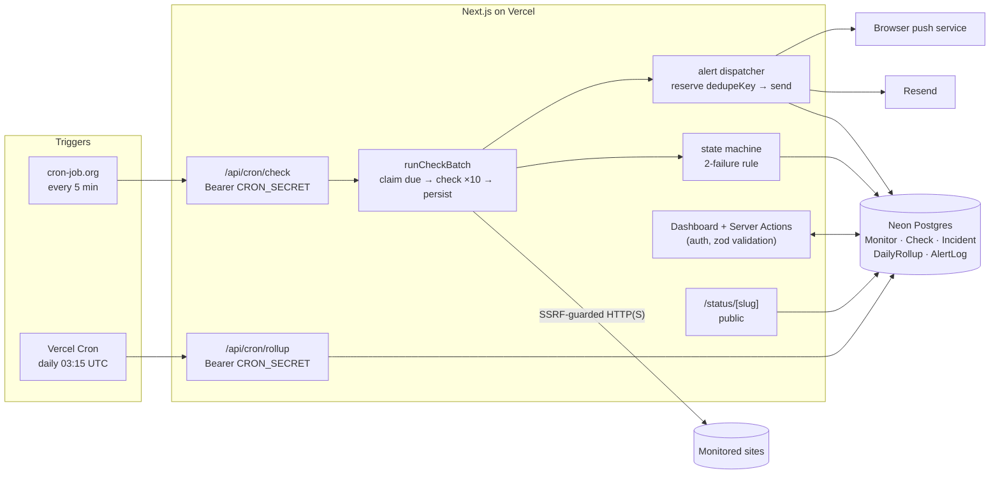

# Heartbeat

Uptime monitoring for student projects, club sites and small business websites: checks every 5 minutes, emails and push-notifies you when a site goes down, and gives you a public status page to share.

**Live app:** TODO — add the deployed URL here after the first Vercel deploy.

## Who is this for and what problem does it solve?

Student portfolios, hackathon projects, college club sites and small business websites usually run on free tiers. They go down quietly: a free database pauses, a Render instance sleeps and never wakes, a deploy breaks the build, a domain or SSL certificate expires. Nobody notices until a recruiter clicks the portfolio link or a customer can't load the menu.

Heartbeat watches those URLs for you. It only alerts on real outages (two failed checks in a row, not one blip), tells you once when it goes down and once when it recovers, warns you two weeks before your SSL certificate expires, and gives you a public status page you can put in a README or share with your club.

## Screenshots

TODO: sign in to the deployed app with your own account, add your real monitors, let it collect a day of checks, then save screenshots of the dashboard, a monitor page, the public status page and the add-monitor form (desktop and 360px mobile) to `docs/` and link them here.

## Features

- **Email + password accounts** — bcrypt (cost 12), httpOnly session cookie, only an HMAC of the session token stored in the DB, rate-limited sign-in and sign-up.
- **Monitors** — URL, method (GET/HEAD/POST), expected status code, optional keyword that must appear in the response, timeout (1–30 s), interval (5/10/30/60 min), SSL certificate expiry check. "Test now" runs a real check before you save.
- **SSRF protection** — localhost, private ranges (10/8, 172.16/12, 192.168/16, CGNAT, link-local), cloud metadata (169.254.169.254, `metadata.google.internal`), `.local`/`.internal`, private IPv6, IPv4-mapped IPv6 and odd encodings like `http://2130706433` are refused at save time. At check time the resolved IP is validated on the socket's own DNS lookup, so DNS rebinding and redirects to internal hosts are blocked too.
- **Checker** — `POST /api/cron/check` protected by `CRON_SECRET`, called every 5 minutes by cron-job.org. Each run atomically claims only *due* monitors (`FOR UPDATE SKIP LOCKED`), checks them 10 at a time with a per-request timeout, stops starting new checks after a 20 s budget and hands the rest to the next run.
- **Incidents without false alarms** — a monitor is marked DOWN only after 2 consecutive failures. An incident opens (dated from the first failure), closes on the first success, and records its duration. A partial unique index guarantees at most one open incident per monitor.
- **Alerts** — email (Resend) and web push on down and on recovery. Each alert is reserved in the DB under a unique key (incident + kind + channel) *before* sending, so retries and overlapping runs can never send duplicates. An SSL certificate expiring within 14 days triggers exactly one warning per certificate.
- **Dashboard** — every monitor with status, uptime % for 24 h / 7 d / 30 d, response-time sparkline, recent incidents; monitor page with response-time chart (24 h / 7 d / 30 d), 90-day bars, incident log, pause/resume, check now.
- **Public status page** per project at `/status/<slug>` — overall status, 90-day uptime bars per monitor, past incidents, optional owner note ("Planned maintenance Saturday 10–11"). URLs and error details are never shown publicly.
- **Data retention** — raw checks are kept for 30 days; a daily job folds older checks into one row per monitor per day and deletes the raw rows, in one transaction.
- **Paper (light) theme by default, dark on request** — the look is a printed ECG strip: warm paper, a pink millimetre grid behind the trace and charts, ink-stamp status tags. Press `t` (or the toggle) for the dark terminal theme; the choice is remembered and applied before first paint, so there is no flash.
- **Usage tracking** — a `UsageEvent` table counts sign-ups, sign-ins, monitors created, status page views and push opt-ins. It stores an event name and optional user id only: no IPs, no user agents, no third-party analytics.

## Tech stack

Next.js 16 (App Router, Server Actions) · TypeScript (strict) · Tailwind CSS v4 · PostgreSQL on Neon · Prisma 7 (driver adapter `@prisma/adapter-pg`) · zod · bcryptjs · Resend · web-push (VAPID) · Vitest

## Architecture



**One check run, step by step**

1. `UPDATE … WHERE id IN (SELECT … WHERE nextCheckAt <= now AND not claimed … FOR UPDATE SKIP LOCKED) RETURNING …` claims up to 60 due monitors and sets `claimedUntil = now + 2 min`.
2. Checks run with a concurrency of 10. Each request has its own timeout; DNS answers are validated on connect; redirects (max 5) are re-validated per hop; the TLS certificate's `valid_to` is captured from the first hop.
3. For each result, a pure function (`buildOutcome`) computes the new state, next check time and incident action; one transaction writes the check, the monitor and the incident.
4. Incident opened/closed or SSL expiring → alerts are planned per channel, reserved in `AlertLog` with a unique `dedupeKey`, then sent.
5. Monitors not started within the 20 s budget are released for the next run.

## Design decisions

1. **External 5-minute cron (cron-job.org) instead of Vercel Cron for checks.** Vercel's Hobby plan only runs cron jobs once a day, which is useless for uptime. cron-job.org is free, runs every minute if needed, and sends a custom `Authorization` header. *Alternatives:* a long-running worker on Render/Railway (free instances sleep, which defeats the purpose), GitHub Actions schedules (not guaranteed to run on time, often delayed 10+ minutes). *Trade-off:* one more external service to configure; if it stops calling, nothing is checked (mitigated by the response JSON and cron-job.org's own failure emails). The once-a-day rollup *does* use Vercel Cron, since daily is exactly what it needs.
2. **Claim-then-check with `FOR UPDATE SKIP LOCKED` and a `claimedUntil` lease.** Cron services retry and occasionally overlap. Claiming in a single SQL statement means two runs split the work rather than double-checking and double-alerting. *Alternative:* a separate queue (Upstash/QStash) — more moving parts and another free-tier limit. *Trade-off:* a crashed run leaves monitors claimed for up to 2 minutes; they're simply checked on the next tick.
3. **Alert idempotency via a unique key reserved before sending.** `AlertLog.dedupeKey` is unique (`down:<incidentId>:EMAIL`, `ssl:<monitorId>:<expiry-date>:PUSH`, …). Insert with `ON CONFLICT DO NOTHING`; only the run that inserted the row sends. *Alternative:* boolean flags on the incident — racy across concurrent runs. *Trade-off:* at-most-once delivery: if Resend fails after the reservation, that alert is recorded as `FAILED` and not retried automatically.
4. **SSRF check inside the socket's DNS lookup, not before the request.** Validating a hostname and then connecting lets an attacker's DNS answer differently the second time (DNS rebinding). Passing a guarded `lookup` to Node's `http.request` validates the exact IP being connected to, on every redirect hop. *Alternative:* resolve once and connect by IP — breaks TLS SNI/certificate checks unless handled carefully. *Trade-off:* uses Node's `http`/`https` modules rather than `fetch`.
5. **Raw checks for 30 days, daily rollups after.** At 5-minute intervals one monitor writes 8,640 rows a month; Neon's free tier is 0.5 GB. Rollups keep 90-day bars cheap (one row per day) while 24 h/7 d/30 d stats stay exact. Uptime math is weighted for partial days so a window starting mid-day doesn't over-count that day. *Trade-off:* response-time detail older than 30 days is reduced to a daily average.

## How to run locally

Requirements: Node 20+ and a Postgres database (a free Neon project is easiest).

```bash
npm install
cp .env.example .env        # fill in DATABASE_URL, DIRECT_URL, CRON_SECRET, SESSION_SECRET (+ Resend/VAPID for alerts)
npm run db:migrate          # creates tables, indexes and constraints
npm run dev                 # http://localhost:3000
```

Trigger a check run by hand, exactly as cron-job.org would (the dev server must be running):

```bash
npm run check:once          # POST /api/cron/check with your CRON_SECRET
npm run rollup:once         # POST /api/cron/rollup
```

Other scripts: `npm test` (Vitest), `npm run lint`, `npm run typecheck`, `npm run build`.

**What the tests cover:** due-monitor selection, the 2-failure rule and recovery, incident open/close and duration, alert idempotency (including SSL warn-once), uptime % with partial days, rollup aggregation and merge, `CRON_SECRET` enforcement, SSRF blocking (IPv4/IPv6/encodings/hostnames), the batch runner's time budget, input validation and rate limiting.

## Deploy

Free tiers only: **Vercel Hobby** (app) + **Neon Free** (Postgres) + **Resend Free** (email) + **cron-job.org** (5-minute trigger).

1. **Neon:** create a project. Copy the *pooled* connection string to `DATABASE_URL` and the *direct* one (no `-pooler` in the host) to `DIRECT_URL`.
2. **Migrate:** from your machine, with those values in `.env`, run `npm run db:deploy`.
3. **Vercel:** import the GitHub repo. Add these environment variables (Production):
   `DATABASE_URL`, `DIRECT_URL`, `CRON_SECRET`, `SESSION_SECRET`, `APP_URL` (your `https://….vercel.app` URL), `RESEND_API_KEY`, `EMAIL_FROM`, `NEXT_PUBLIC_VAPID_PUBLIC_KEY`, `VAPID_PRIVATE_KEY`, `VAPID_SUBJECT`. Deploy. The build runs `prisma generate` automatically.
4. **Daily rollup:** `vercel.json` already schedules `/api/cron/rollup` daily. Vercel sends `Authorization: Bearer $CRON_SECRET` automatically.
5. **5-minute checks — cron-job.org** (Vercel Hobby cron can only run once a day, so it can't do this):
   - Create a free account → *Create cronjob*.
   - URL: `https://<your-app>.vercel.app/api/cron/check`, schedule: every 5 minutes.
   - *Advanced* → Request method `POST`, add header `Authorization: Bearer <your CRON_SECRET>`, timeout 60 s.
   - Enable "notify me on failure" so you hear about it if the checker itself breaks.
6. **Email:** with `onboarding@resend.dev` as sender, Resend only delivers to your own Resend account email. To alert other users, verify a domain in Resend and set `EMAIL_FROM` to an address on it.
7. Add the live URL at the top of this README.

## Limitations and what breaks at scale

- **Single region, single vantage point.** Checks run from one Vercel region. A regional network issue between Vercel and a site looks like an outage; real uptime services confirm from several locations before alerting.
- **Throughput ceiling.** One run checks up to 60 monitors in a ~20 s budget. Past a few hundred monitors per 5 minutes, runs fall behind (monitors are checked late, never skipped). The fix is sharding: call the endpoint with a shard parameter several times per tick, or move checking to a queue (QStash/SQS) with workers.
- **Database growth.** Each 5-minute monitor writes ~8.6k rows/month before rollup. Neon's free 0.5 GB holds roughly a few hundred monitors' 30-day history. Beyond that: partition `Check` by month and drop partitions instead of `DELETE`.
- **At-most-once alerts.** A failed email is logged, not retried. A retry worker for `AlertLog.state = FAILED` would fix it.
- **Resend free tier:** 100 emails/day, and without a verified domain it only emails the account owner.
- **Web push on iPhone** only works when the site is added to the home screen (iOS 16.4+).
- **"Slow" is a UI hint only** (response > 2 s or > 3× the recent median). It doesn't alert.
- **No team accounts, no 2FA, no password reset email yet.**
- **POST checks send an empty body** — fine for health endpoints, not for APIs that need a payload.

## What I learned

- Serverless is great until something must run on a schedule. Designing around "a function that can be called twice, late, or not at all" (claims, leases, idempotency keys) mattered more than the HTTP code.
- Uniqueness constraints are the simplest correct concurrency control: a partial unique index for "one open incident" and a unique alert key replaced a lot of fragile application logic.
- SSRF is subtle. Blocking `localhost` in a form is easy; blocking DNS rebinding, IPv4-mapped IPv6, decimal IPs and redirects to metadata endpoints means validating at the socket level.
- Uptime percentages are easy to get subtly wrong (partial days, no-data vs 100%, rounding 99.996% up to 100%). Writing tests first exposed every one of those.

## What I'd improve next

- Multi-region confirmation (check from a second region before declaring DOWN) to remove the remaining false positives.
- Automatic retry of failed alerts, plus Slack/Discord webhooks — that's where student teams actually talk.
- Password reset and email verification, then team projects so a whole club can share one status page.

## Repo metadata

**About (GitHub description):** Uptime monitor for student and small-business sites: 5-minute checks, email + push alerts, SSL expiry warnings and public status pages. Next.js, Postgres, free-tier deployable.

**Topics:** `uptime-monitoring` · `nextjs` · `postgresql` · `status-page` · `web-push`
